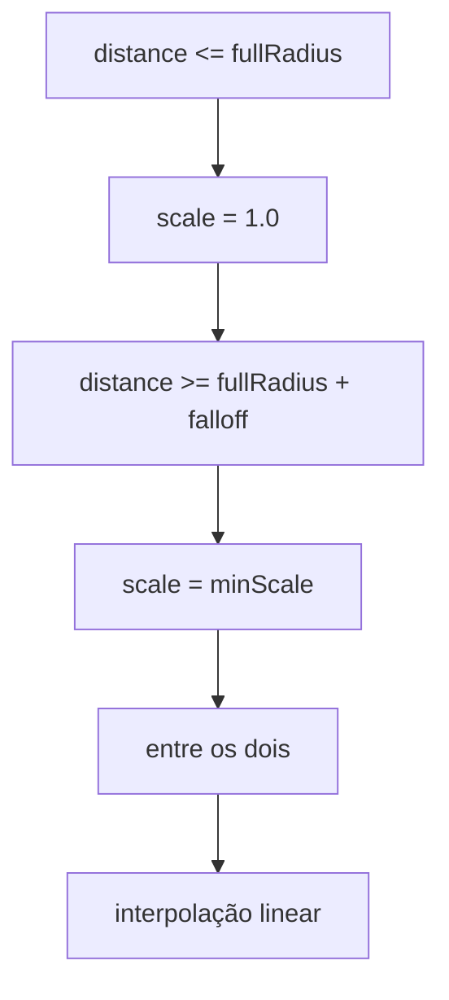
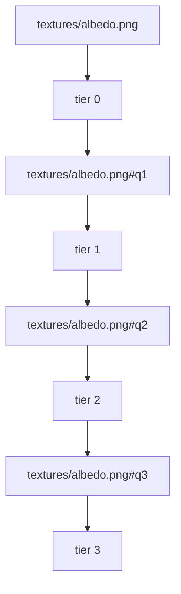

# Texture Quality LOD — Distance to Viewers

<div class="doc-meta">
  <span class="doc-badge doc-badge--reference">Reference</span>
  <span><strong>Namespace:</strong> `Caffeine::Render`</span>
  <span>Last verified: <time datetime="2026-11-18">2026-11-18</time></span>
  <span>Source: <a href="https://github.com/devscafecommunity/caffeine/blob/main/src/caffeine/render/TextureQuality.hpp"><code>render/TextureQuality.hpp</code></a></span>
</div>

<p class="doc-lede">Como o renderer escolhe um tier de textura GPU menor para objectos
distantes da câmara activa, e que definições estão realmente ligadas hoje.</p>

> **Ficheiros:** `src/caffeine/render/TextureQuality.hpp`, `GpuTextureCache.hpp` / `.cpp`
> **Estado:** implementado (GPU scene renderer, editor e runtime)

---

## Visão Geral

O **sistema de LOD de qualidade de textura** reduz a resolução das texturas GPU de acordo com
a distância entre o objecto e os visualizadores activos. As texturas não são removidas — é
usada uma entrada de cache com dimensões menores.

Objectivos:

- Menos memória GPU em cenas grandes
- Menos banda de textura em objectos distantes
- Qualidade total perto da câmara (câmara do editor, `Camera3D`, preview de câmara)

---

## Visualizadores

A distância usada em cada draw é a **mínima** entre a posição do objecto e cada visualizador
activo; sem lista explícita, usa-se a posição da câmara de render:

| Contexto | Visualizadores |
|----------|----------------|
| Viewport da cena | Câmara de render fornecida pelo chamador (`GpuSceneRenderOptions::textureQualityViewers` quando definida) |
| Preview de câmara | A câmara do preview |
| Runtime | A câmara activa |

```cpp
const f32 dist = distanceToNearestViewer(worldPos, options.textureQualityViewers);
const u32 tier = textureQualityTier(dist, options.textureQuality);
```

---

## Curva de qualidade

As definições estão em `TextureQualitySettings`:

| Campo | Default | Descrição |
|-------|---------|-----------|
| `enabled` | `true` | Liga/desliga o LOD |
| `fullRadius` | `35.0` m | Dentro deste raio → tier 0 (100%) |
| `falloffDistance` | `100.0` m | Decaimento linear para além do raio |
| `minScale` | `0.25` | Escala mínima no limite do falloff (1/4 da resolução) |

### Escala contínua




### Tiers discretos (cache GPU)

| Tier | Escala aprox. | Exemplo (fonte 1024²) |
|------|---------------|-----------------------|
| 0 | 100% | 1024 × 1024 |
| 1 | 50% | 512 × 512 |
| 2 | 25% | 256 × 256 |
| 3 | 12.5% | 128 × 128 (mín. 16 px) |

Limites em `textureQualityTier()`: `>= 0.75` → tier 0, `>= 0.375` → tier 1,
`>= 0.1875` → tier 2, caso contrário tier 3.

---

## GpuTextureCache

Cada tier é uma entrada de cache separada:




### API

```cpp
RHI::Texture* acquire(RHI::RenderDevice* device, const std::string& path,
                      const std::string& projectRoot, u32 qualityTier = 0,
                      bool srgb = false);
RHI::Texture* acquireFromPixels(RHI::RenderDevice* device, const std::string& cacheKey,
                                const u8* pixels, u32 width, u32 height, int channels,
                                u32 qualityTier = 0, bool srgb = false);
```

No upload (`loadTexture`):

1. Descodifica a imagem original (tier 0)
2. `downscaleRgba()` reduz o buffer para metade por cada tier
3. Faz upload das dimensões reduzidas e gera mipmaps

`release()` e `invalidate()` percorrem **todos** os tiers do caminho (e os dois estados sRGB);
`releaseAll()` limpa a cache no shutdown do device.

---

## Integração no render

### GpuSceneRenderOptions

```cpp
struct GpuSceneRenderOptions {
    bool wireframeMeshes = false;
    bool enableShadows   = true;
    TextureQualitySettings textureQuality{};
    std::vector<Vec3>      textureQualityViewers;
};
```

### GpuSceneRenderer

Em `gatherMeshDraws()`, cada `MeshDraw` recebe `viewerDistance` (centro da AABB ou centro do
chunk de terreno).

Em `resolveMeshAlbedo()` e no binding do splat do terreno:

```cpp
const u32 tier = textureQualityTier(draw.viewerDistance, options.textureQuality);
auto* tex = GpuTextureCache::instance().acquire(m_device, path, projectRoot, tier, srgb);
```

---

## Definições e limites

O `EditorContext` ainda declara `textureQualityEnabled`, `textureQualityRadius`,
`textureQualityFalloff` e `textureQualityMinScale`, mas nenhum painel de definições, ficheiro de
preferências ou chamada da C ABI os lê. O renderer corre por isso com os defaults de
`TextureQualitySettings` acima; um frontend que queira outros valores tem de preencher
`GpuSceneRenderOptions::textureQuality`.

---

## Diagrama de fluxo

```mermaid
flowchart TD
  Viewer_positions["Viewer positions"] --> m[""]
  n[""] --> _["▼"]
  distanceToNearestViewer_meshCenter_["distanceToNearestViewer(meshCenter)"] --> m[""]
  textureQualityTier_distance__settings_["textureQualityTier(distance, settings)"] --> m[""]
  GpuTextureCache__acquire_path__tier_["GpuTextureCache::acquire(path, tier)"] --> m[""]
  n[""] --> __cache_hit["─ cache hit"]
  __cache_hit["─ cache hit"] --> bind_texture_existente["bind textura existente"]
  bind_texture_existente["bind texture existente"] --> __cache_miss["─ cache miss"]
  __cache_miss["─ cache miss"] --> load___downscale___upload_GPU["load + downscale + upload GPU"]
```


---

## Limitações

| Item | Notas |
|------|-------|
| Sem transição suave | A troca de tier é discreta; não há blend entre resoluções |
| Downscale no load | Sem filtro GPU separado; filtro box em CPU (`downscaleRgba`) |
| Terreno | As camadas de splat usam o mesmo tier por chunk |
| Normal maps | Seguem o mesmo tier do albedo |

---

## Ver também

- [Scene Viewport](../editor/scene-viewport.md) — visualizadores e `GpuSceneRenderOptions`
- [Sessão 2026-09-22](../plans/2026-09-22-viewport-rendering-quality-session.md) — changelog completo
- [Asset Manager](../assets/asset-manager.md) — carregamento de imagens
- [Mesh LOD](mesh-lod.md) — LOD de geometria, um caminho separado
