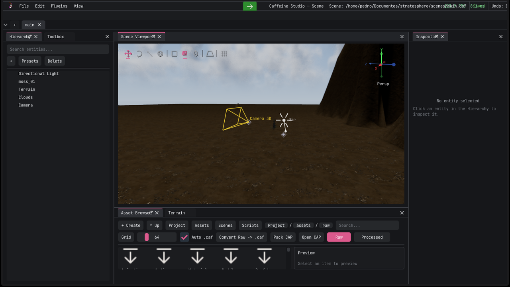

# Terrain System

<div class="doc-meta">
  <span class="doc-badge doc-badge--stable">Stable</span>
  <span><strong>Namespace:</strong> `Caffeine::Terrain`, `Caffeine::ECS::TerrainComponent`</span>
  <span><strong>Ficheiros:</strong> `src/caffeine/terrain/`, `src/caffeine/ecs/TerrainComponents.hpp`</span>
  <span>Last verified: <time datetime="2026-11-18">2026-11-18</time></span>
  <span>Source: <a href="https://github.com/devscafecommunity/caffeine/blob/main/src/caffeine/ecs/TerrainComponents.hpp"><code>ecs/TerrainComponents.hpp</code></a></span>
</div>

<p class="doc-lede">O heightfield editável: mesh e LOD por chunks, pintura de splat, colisão
grosseira, o Terrain Editor nativo e o formato <code>.cterrain</code>.</p>

> **Geração procedural:** o Terrain Generator do Doppio (C ABI v8); o
> `terrain_plugin` legado está em [`terrain-plugin.md`](terrain-plugin.md)

---

## Visão Geral

O terreno na Caffeine é um **heightfield** editável: dados em `TerrainHeightmap`, render via
`TerrainMeshBuilder` + LOD por chunk, pintura de splat em `TerrainSplatmap`. O engine **não**
traz geração procedural no core. O separador **Terrain** do Doppio constrói heightfields
com um grafo de nós e coloca-os pela C ABI v8; o `terrain_plugin` legado continua para o
host C++.

**Separação de responsabilidades:** o Terrain Editor, as ferramentas de sculpt/paint e o I/O
`.cterrain` são funcionalidades nativas do engine. A geração procedural vive no separador
Terrain do Doppio; o `terrain_plugin` legado mantém a versão do host C++.

| Camada | Responsabilidade |
|--------|------------------|
| **Core** | Heightmap, mesh, LOD, colisão grosseira, sculpt/paint, `.cterrain` |
| **Terrain Editor (nativo)** | Sculpt, pintura de splat, undo e import/export `.cterrain` |
| **Terrain Generator (separador Doppio)** | Presets, grafo de nós, splat layers, Place in scene |
| **terrain_plugin (legado)** | Algoritmo Node.js e import de heightmap para o host C++ |

---

## TerrainComponent

```cpp
struct TerrainComponent {
    u32 resolutionX = 257;
    u32 resolutionZ = 257;
    u32 splatResolutionScale = 2;          // splatmap mais grosseira que o heightmap
    f32 worldSizeX = WorldUnits::kDefaultTerrainSizeM; // metros (1 u = 1 m)
    f32 worldSizeZ = WorldUnits::kDefaultTerrainSizeM;
    f32 maxHeight = WorldUnits::kDefaultTerrainHeightM;

    u32 dataRevision = 1;                  // incrementa quando alturas/splat mudam
    u32 meshRevision = 0;
    u32 splatRevision = 1;
    bool castShadows = true;
    bool receiveShadows = true;

    char texturePath[256];                 // albedo de chão por defeito
    char normalMapPath[256];               // normal map triplanar (GPU)
    f32  textureTileSize = 8.0f;
    f32  shininess = 16.0f;                // legado; o sombreamento do terreno não tem especular
    Vec3 tint{1.0f, 1.0f, 1.0f};           // multiplica o albedo amostrado

    bool useSplatmap = true;
    char splatLayerPaths[4][256];          // defaults Grass, Rock, Sand, Dirt
    f32  splatTileSize = 8.0f;

    bool useChunks = true;
    u32 chunkVertexCount = 33;
    u32 maxLodLevels = 2;
    bool frustumCull = true;
    f32 lodDistanceScale = 520.0f;
    f32 lodHysteresis = 0.25f;

    u32 collisionSampleStep = 4;           // 4 = ~16x menos triângulos
    bool buildCollisionMesh = true;

    char terrainDataPath[256];             // caminho .cterrain no projecto
};
```

O heightmap interno guarda valores **normalizados** `[0, 1]`. Na mesh, `y = sample *
maxHeight`.

---

## Pipeline de dados

- `TerrainComponent (ECS)`
- `▼`
- `TerrainCache::initializeEntity / syncEntity`
  - `TerrainHeightmap (CPU, editável)`
  - `TerrainSplatmap (4 camadas)`
  - `Mesh3D render (TerrainMeshBuilder + tangentes)`
  - `Mesh3D collision (TerrainCollisionMeshBuilder, decimado)`
  - `TerrainChunk[] (LOD + frustum cull)`


### TerrainMeshBuilder

- Gera vértices com a normal do heightmap (`sampleNormalBilinear`).
- UVs em tiling conforme `textureTileSize` / `splatTileSize`.
- **Tangentes** calculadas por triângulo (base para normal mapping).

### Colisão

`TerrainCollisionMeshBuilder` reutiliza `buildRegion` com `collisionSampleStep` (por exemplo 4 →
~16× menos triângulos). Acesso via `TerrainCache::collisionMeshFor(entity)`.

---

## Editor

| Painel | Função |
|--------|--------|
| **Inspector → Terrain** | Resolução, tamanho, LOD, splat, colisão, Normal Map, Shininess |
| **Terrain Editor (nativo)** | Sculpt (raise/lower/smooth/flatten/noise), pintura de splat, import/export `.cterrain` |

### Terrain Editor nativo

<figure class="doc-figure">
  
  <figcaption>Terreno com texturas de chão naturais</figcaption>
</figure>


Abre-o em **View → Terrain Editor**, na paleta de comandos (**Terrain Editor**), ou no botão
**Open Terrain Editor** da Toolbox com uma entidade Terrain seleccionada.

| Ferramenta | Comportamento |
|------------|---------------|
| **Raise / Lower** | Adiciona ou remove altura com um falloff suave |
| **Smooth** | Média da vizinhança local |
| **Flatten** | Achata para a altura sob o primeiro clique do traço |
| **Noise** | Adiciona detalhe determinístico |
| **Splat paint** | Pinta pesos de Grass, Rock, Sand ou Dirt |
| **Reset default textures** | Restaura os caminhos por defeito e a camada Grass |
| **Data tab** | Edita o caminho `.cterrain` e importa/exporta o ficheiro |

Traços rápidos são interpolados entre frames em vez de aplicar só uma vez por frame. Os
snapshots de undo/redo incluem o heightmap e o splatmap, por isso **Ctrl+Z** restaura edições do
terreno em vez de o repor plano.

Terrenos novos começam com a camada **Grass** e texturas naturais de chão 1k de
`assets/hdr-assets-texture` (dirt/rock/moss, rocks, dirt e mud). A cor **Tint** do Inspector
multiplica o albedo amostrado.

Cenas criadas antes deste default guardavam um terreno sem pintura como a antiga camada
**Light**. Ao carregar esse `.cterrain`, o splatmap Light uniforme é migrado para Grass e os
caminhos Kenney de protótipo não tocados são actualizados para o conjunto natural.

Geração procedural: painel **Terrain Generator** (plugin). O plugin não é dono do sculpt nem da
pintura.

---

## Render GPU

Com `CF_HAS_SDL3`, o terreno usa `terrain_lit.frag`:

- Difuso Lambert mais IBL do céu; a superfície é um dieléctrico rugoso, sem lóbulo especular.
- Normal map **triplanar** via a cache GPU de texturas do terreno (sampler slot 5).
- Sombras direcionais (slots 6–7), cubemaps pontuais (slots 8–9) e mapas de spot (slots 10–11).
- Splat map no slot 0 e as quatro camadas nos slots 1–4.
- `castShadows` / `receiveShadows` são lidos em `GpuSceneRenderer::gatherMeshDraws`.

Ver [`rendering/materials-phong.md`](../rendering/materials-phong.md) e
[`rendering/shadow-mapping.md`](../rendering/shadow-mapping.md).

---

## Serialização

O `SceneSerializer` grava o `TerrainComponent` no blob da cena (versão **11** do blob de
terreno). A versão 9 adicionou `collisionSampleStep` e `buildCollisionMesh`; a versão 10
adicionou `normalMapPath` e `shininess`; a versão 11 adicionou `tint`. Campos de geração
antigos (v2–v8) são lidos e descartados por compatibilidade. Os dados pesados de altura/splat
vivem no `.cterrain` referenciado por `terrainDataPath`.

---

## API útil

```cpp
TerrainCache& cache = TerrainCache::instance();
cache.initializeEntity(world, entity);
cache.heightmapFor(entity)->setNormalized(x, z, h);
cache.syncEntity(world, entity);

Terrain::importHeightmapFile(world, entity, path, worldSizeX, worldSizeZ);
```
